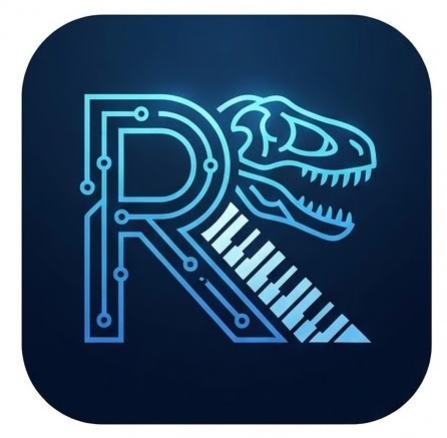
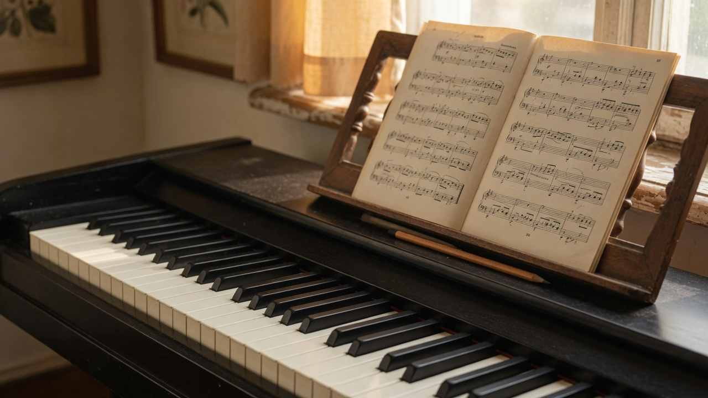
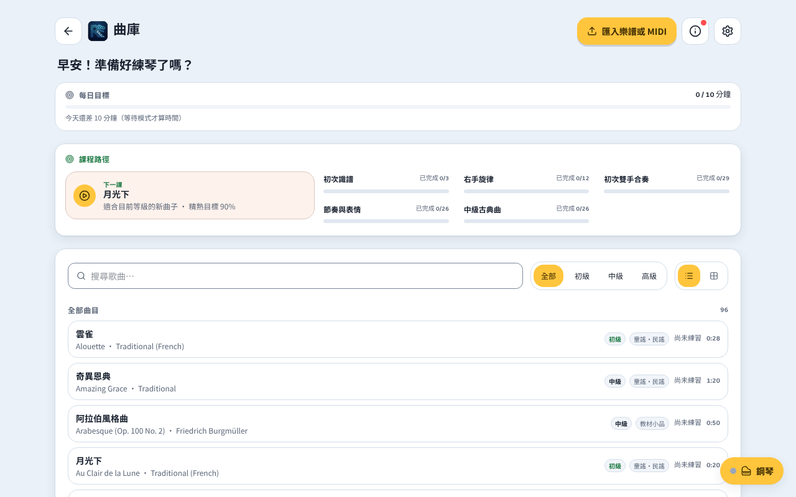
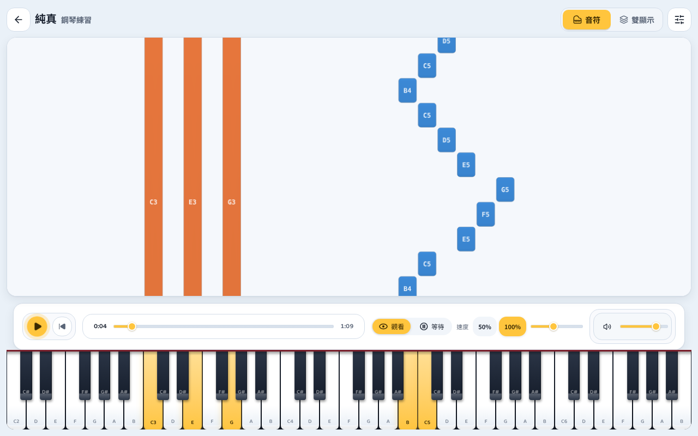
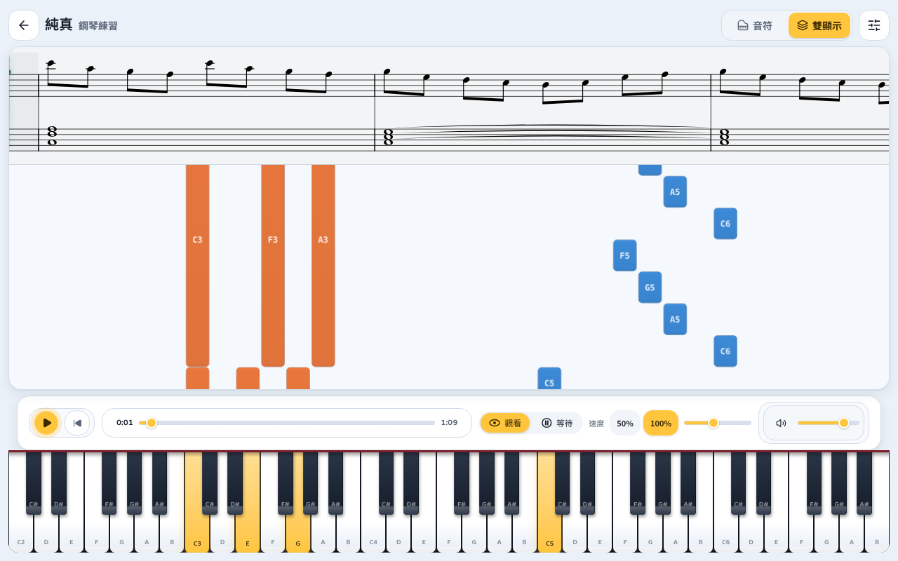

<p align="center">
  
</p>

<h1 align="center">Rexiano</h1>

<p align="center">
  免費的網頁鋼琴練習 — 下落音符、五線譜與 MIDI，裝成 App 後可離線使用。<br>
  一位爸爸為 Rex 打造，並分享給所有學琴的人。
</p>

<p align="center">
  <strong>繁體中文</strong> · <a href="README.md">English</a>
</p>

<p align="center">
  和 <strong>Synthesia</strong> 不同：Rexiano 免費、開源、打開瀏覽器就能練，並提供 Watch 與 Wait 練習模式。
</p>

<p align="center">
  <a href="https://rexiano.vercel.app/"><strong>在瀏覽器開啟 Rexiano → rexiano.vercel.app</strong></a><br>
  <sub>電腦與平板 · Chrome / Edge 可連藍牙鋼琴（iPad 用 Bluefy）· 可安裝成 PWA 離線使用</sub>
</p>

<p align="center">
  
</p>

<p align="center"><sub>氣氛照片，不是 app 畫面。真實截圖在下方。</sub></p>

<table>
  <tr>
    <td width="33%" align="center">
      <br>
      <sub>曲庫：96 首內建曲目、課程路徑、篩選與最近開啟。</sub>
    </td>
    <td width="33%" align="center">
      <br>
      <sub>練習畫面：下落音符、鍵盤回饋、觀看／等待與速度控制。</sub>
    </td>
    <td width="33%" align="center">
      <br>
      <sub>雙顯示：五線譜與下落音符同步捲動。</sub>
    </td>
  </tr>
</table>

## 開始練習

1. 用 Chrome 或 Edge 開啟 [rexiano.vercel.app](https://rexiano.vercel.app/)。
2. 選擇內建曲目，或拖入自己的 `.mid` / `.midi` / `.musicxml` 檔案。匯入的檔案會存在這個瀏覽器裡，之後可從「最近開啟」或曲庫直接重開。
3. 先用 **Watch** 模式聽與看，再切到 **Wait** 模式，讓 Rexiano 等你彈對音符才繼續。
4. 連上藍牙鋼琴：彈的音會即時回饋和計分，曲子也會從鋼琴彈出來（等待模式只彈你沒在練的那一手）。

只聽音樂與看視覺化不需要鋼琴；也可以直接點畫面上的琴鍵。Rexiano 只支援藍牙（BLE-MIDI）鋼琴，例如 Roland、Yamaha Clavinova、Kawai、Casio 的藍牙款；沒有藍牙的琴可加裝 Yamaha MD-BT01 或 CME WIDI Master。

想離線練琴：在 Chrome / Edge 網址列點「安裝」，Rexiano 會變成獨立 App，內建曲目與音色會先下載好。裝好後也可以直接用 Rexiano 開啟 `.mid` 檔。

## 瀏覽器支援

| 裝置                         | 練習與播放 | 藍牙鋼琴                  |
| ---------------------------- | ---------- | ------------------------- |
| Windows / macOS / Linux 電腦 | ✅         | Chrome、Edge              |
| Android 平板                 | ✅         | Chrome                    |
| iPad                         | ✅         | Bluefy 瀏覽器，見下方說明 |
| 手機                         | 不支援     | 版面以電腦與平板為主      |

**iPad 連藍牙鋼琴**：iPadOS 上所有瀏覽器（包含 Chrome）都用 Safari 的核心，沒有 Web Bluetooth。請到 App Store 安裝免費的 [Bluefy](https://apps.apple.com/app/id1492822055)，用它開啟 Rexiano 網址，再按「連接鋼琴」。Rexiano 在 iPad 的 Safari 裡也會顯示這個說明。

練習紀錄存在瀏覽器裡。換瀏覽器或清除網站資料前，請先在設定的「使用者資料備份」匯出。桌面版（1.6.0）的備份檔也可以在這裡匯入。

## 特色

| 面向     | Rexiano 幫你做到                                                                       |
| -------- | -------------------------------------------------------------------------------------- |
| 視覺學習 | 60 FPS 下落音符、88 鍵高亮、音名標籤，以及左右手分色。                                 |
| 五線譜   | 只看下落音符，或五線譜和下落音符一起顯示、同步捲動。                                   |
| 聚焦練習 | Watch、Wait、Free 模式，加上速度控制、分手練習、節拍器、預備拍與歷史進度。             |
| 藍牙鋼琴 | 琴鍵進來計分、判斷等待模式；曲子從鋼琴彈出來，等待模式只彈另一手。                     |
| 音色     | 內建 FreePats Upright Piano KW SoundFont，透過 Web Audio 播放，並保留合成器 fallback。 |
| 曲目     | 96 首內建曲目，依 L0–L8 分級；也可拖放匯入自己的 MIDI 與 MusicXML。                    |

## 內建曲目

96 首，每首都有 L0–L8 分級與五線譜：

- **童謠與民謠**：從單手開始，再到雙手
- **古典名曲**：給愛麗絲、G 大調小步舞曲、卡農、土耳其進行曲等
- **教材小品**（62 首）：拜耳 Op.101 第 8–31 首（剛開始雙手）、車爾尼 Op.821、布格繆勒 25 首練習曲 Op.100、巴哈《安娜·瑪德蓮娜筆記本》、莫札特 K.2、克萊曼第小奏鳴曲 Op.36 No.1 三個樂章、庫勞 Op.20 No.1、柴可夫斯基《兒童曲集》

內建曲目都是公有領域作品。教材小品由 `scripts/mutopia/` 從 [Mutopia Project](https://www.mutopiaproject.org) 與 [Nathanael Meister 的鋼琴教材](https://github.com/nathanaelmeister/piano_-_first_two_hand_exercises) 的 LilyPond 原始檔轉換。

## 藍牙鋼琴

按「連接鋼琴」，在瀏覽器跳出的視窗選你的鋼琴。同一個連線雙向使用：

- **琴鍵進來**：計分、等待模式判斷彈對沒有
- **曲子出去**：設定裡「曲子從哪裡出聲」選「鋼琴」時，曲子從鋼琴彈出來，電腦會靜音；選「這台裝置」則用電腦喇叭
- 觀看模式整首都彈；等待模式只彈你沒在練的那一手；連上時會自動切到平台鋼琴音色
- 鋼琴聲音比畫面慢時，到設定的「鋼琴聲音對齊」往右調

鋼琴已經在系統裡配對好（例如 Mac 的「音訊 MIDI 設定」）時，也可以在「其他連線方式」直接選它。

詳細步驟請看[使用手冊 — 連接藍牙鋼琴](docs/user-guide.md#5-連接藍牙鋼琴)。

## 外觀與更新紀錄

介面和 colormon 等遊戲同一家族，可在設定選擇 跟著系統／淺色／深色。右上角 ⓘ 是更新紀錄，有新版本時會出現小紅點；內容來自 `src/data/changelog.json`，`CHANGELOG.md` 由 `pnpm changelog` 產生。

## 開發

前置需求：[Node.js](https://nodejs.org/) `>=22 <23`、[pnpm](https://pnpm.io/) `>=10 <11` 與 Git。

```bash
git clone https://github.com/EndeavorYen/Rexiano.git
cd Rexiano
pnpm install
pnpm dev
```

常用指令：

| 指令               | 用途                                    |
| ------------------ | --------------------------------------- |
| `pnpm dev`         | 啟動 Vite 開發伺服器，含 HMR。          |
| `pnpm build`       | 型別檢查並建置到 `dist/`（含 PWA）。    |
| `pnpm lint`        | 執行 ESLint。                           |
| `pnpm typecheck`   | 執行 TypeScript 檢查。                  |
| `pnpm test`        | 執行 Vitest 單元測試。                  |
| `pnpm test:e2e`    | 建置後在 Chromium 執行 Playwright E2E。 |
| `pnpm test:visual` | 建置後執行重點 UI 視覺 guard 測試。     |

送出 PR 前請執行：

```bash
pnpm lint && pnpm typecheck && pnpm test
```

更新 README 與介紹頁截圖（中英文）：

```bash
pnpm exec playwright test -c scripts/playwright.readme-screenshots.config.ts
```

## 部署

在 Vercel 匯入這個 repo 即可，設定都在 `vercel.json`（Vite、pnpm、輸出 `dist/`）。推到 `main` 會自動部署，PR 會有預覽網址。

## 專案地圖

```text
src/
  platform/              網頁 platform 層：靜態資源、IndexedDB、檔案選擇與下載（window.api）
  engines/               純邏輯：音頻、下落音符、MIDI、練習
  stores/                Zustand 狀態
  features/              React UI
  themes/                CSS custom property tokens
  shared/                型別與共用驗證
public/                  SoundFont、內建 MIDI 曲目、PWA 圖示
site/                    GitHub Pages 介紹頁
```

## 技術堆疊

| 層級 | 技術                                        |
| ---- | ------------------------------------------- |
| 建置 | Vite 7、vite-plugin-pwa（Workbox）          |
| UI   | React 19、TypeScript 5.9、Tailwind CSS 4    |
| 渲染 | PixiJS 8 下落音符、VexFlow 5 五線譜         |
| 狀態 | Zustand 5                                   |
| MIDI | Web MIDI API、Web Bluetooth、`@tonejs/midi` |
| 音頻 | Web Audio API、`soundfont2`                 |
| 儲存 | IndexedDB、localStorage                     |
| 測試 | Vitest 4、Playwright                        |
| 部署 | Vercel                                      |

## 文件

| 目標             | 繁體中文                                                        | English                                                                  |
| ---------------- | --------------------------------------------------------------- | ------------------------------------------------------------------------ |
| 開始使用 Rexiano | [使用手冊](docs/user-guide.md)                                  | [User Guide](docs/user-guide-en.md)                                      |
| 理解架構         | [架構文件](docs/architecture-zh.md)、[系統設計](docs/DESIGN.md) | [Architecture](docs/architecture.md)、[System Design](docs/DESIGN-en.md) |
| 追蹤專案工作     | [開發路線圖](docs/ROADMAP.md)                                   | [Roadmap](docs/ROADMAP.md)                                               |

## 貢獻

歡迎任何形式的貢獻。改程式碼前，請先閱讀 [CONTRIBUTING.md](CONTRIBUTING.md)、[架構文件](docs/architecture-zh.md)與[系統設計](docs/DESIGN.md)。

請保持變更小、可測試，並符合既有 engine/store/feature 分層。

## 授權

Rexiano 以 [GNU General Public License v3.0](LICENSE) 釋出。你可以依 GPL-3.0 使用、修改與散佈；若散佈修改版本，需以相同授權提供原始碼。

## 致謝

- 為正在學鋼琴的 Rex 而建，以愛打造。
- 教材小品來自 [Mutopia Project](https://www.mutopiaproject.org) 與 [Nathanael Meister](https://github.com/nathanaelmeister/piano_-_first_two_hand_exercises)；鋼琴音色來自 [FreePats](https://freepats.zenvoid.org/)。
- 感謝讓 Rexiano 成為可能的所有開源專案。
