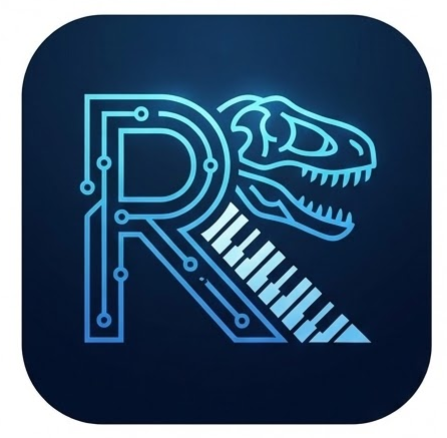
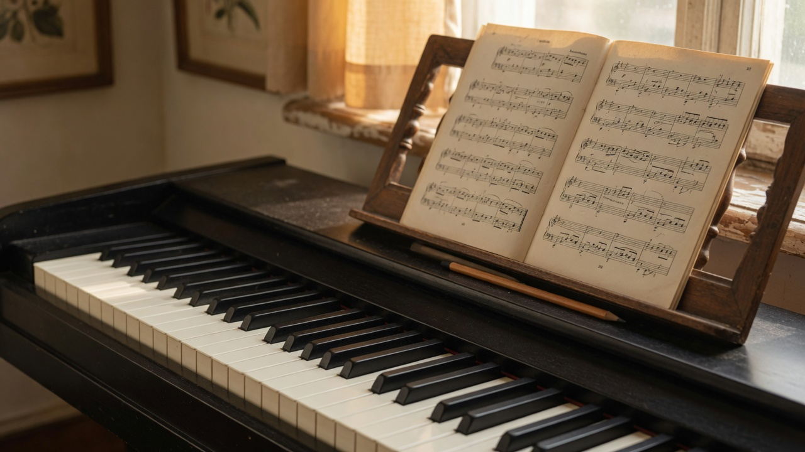
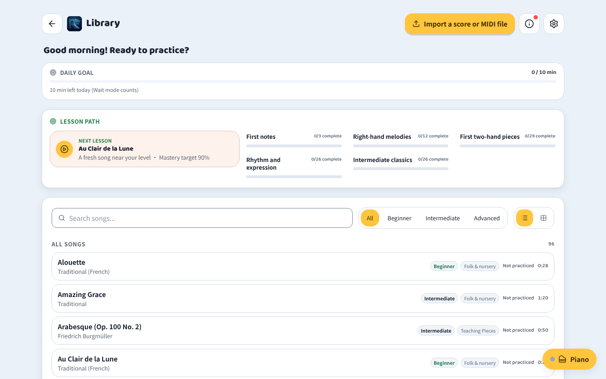
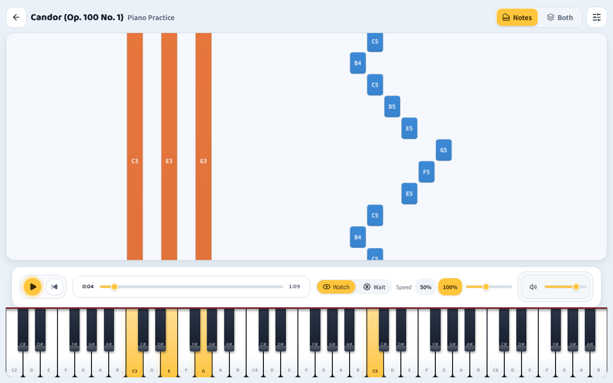
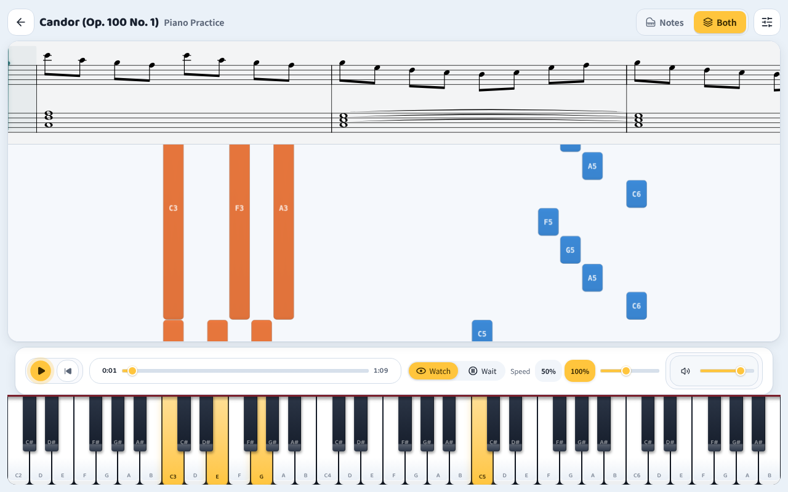

<p align="center">
  
</p>

<h1 align="center">Rexiano</h1>

<p align="center">
  Free piano practice in your browser — falling notes, sheet music, and MIDI. Install it as an app to practice offline.<br>
  Built by a dad for Rex, and shared with anyone learning piano.
</p>

<p align="center">
  <a href="README-zh.md">繁體中文</a> · <strong>English</strong>
</p>

<p align="center">
  Unlike <strong>Synthesia</strong>, Rexiano is free, open source, and runs right in the browser, with Watch and Wait practice modes.
</p>

<p align="center">
  <a href="https://rexiano.vercel.app/"><strong>Open Rexiano in your browser → rexiano.vercel.app</strong></a><br>
  <sub>Computers and tablets · Bluetooth pianos in Chrome / Edge (Bluefy on iPad) · Installable as a PWA for offline use</sub>
</p>

<p align="center">
  
</p>

<p align="center"><sub>Atmosphere photo — not the app. Real screenshots are just below.</sub></p>

<table>
  <tr>
    <td width="33%" align="center">
      <br>
      <sub>Song Library: 96 built-in songs, a lesson path, filters, and recent files.</sub>
    </td>
    <td width="33%" align="center">
      <br>
      <sub>Practice View: falling notes, keyboard feedback, Watch / Wait, and speed control.</sub>
    </td>
    <td width="33%" align="center">
      <br>
      <sub>Split Sheet: notation and falling notes stay in sync.</sub>
    </td>
  </tr>
</table>

## Start Practicing

1. Open [rexiano.vercel.app](https://rexiano.vercel.app/) in Chrome or Edge.
2. Choose a built-in song, or drag in your own `.mid` / `.midi` / `.musicxml` file. Imported files stay in this browser, so you can reopen them from Recent or the library.
3. Start with **Watch** mode, then switch to **Wait** mode when you want Rexiano to pause until you play the right notes.
4. Connect a Bluetooth piano: your playing is scored live, and the song plays on the piano (in Wait mode, only the hand you are not practising).

No piano is needed to listen and watch, and you can tap the on-screen keys. Rexiano supports Bluetooth (BLE-MIDI) pianos only — for example Bluetooth models from Roland, Yamaha Clavinova, Kawai and Casio; a piano without Bluetooth can use a Yamaha MD-BT01 or CME WIDI Master adapter.

To practice offline, click **Install** in the Chrome / Edge address bar. Rexiano becomes a standalone app with the built-in songs and piano sound downloaded ahead of time, and it can open `.mid` files directly.

## Browser Support

| Device                  | Practice & playback | Bluetooth piano                      |
| ----------------------- | ------------------- | ------------------------------------ |
| Windows / macOS / Linux | ✅                  | Chrome, Edge                         |
| Android tablet          | ✅                  | Chrome                               |
| iPad                    | ✅                  | Bluefy browser — see below           |
| Phone                   | Not supported       | Layout targets computers and tablets |

**Bluetooth piano on iPad**: every iPadOS browser, Chrome included, runs on Safari's engine, which has no Web Bluetooth. Install the free [Bluefy](https://apps.apple.com/app/id1492822055) browser, open the Rexiano address there and press Connect piano. Rexiano shows the same steps when opened in Safari on an iPad.

Practice history lives in the browser. Export it from **User Data Backup** in Settings before switching browsers or clearing site data. Backups from the 1.6.0 desktop app import here too.

## Highlights

| Area            | What Rexiano Helps With                                                                                          |
| --------------- | ---------------------------------------------------------------------------------------------------------------- |
| Visual learning | 60 FPS falling notes, 88-key highlighting, note labels, and per-track colors for left/right hand separation.     |
| Sheet music     | Falling notes alone, or sheet music and falling notes together, scrolling in sync.                               |
| Practice focus  | Watch, Wait, and Free modes, plus speed control, split-hand practice, metronome, count-in, and progress history. |
| Bluetooth piano | Your keys in for scoring and Wait mode; the song out to the piano, with only the other hand in Wait mode.        |
| Sound           | Bundled FreePats Upright Piano KW SoundFont with Web Audio playback and a synthesizer fallback.                  |
| Songs           | 96 built-in songs graded L0–L8, plus drag-and-drop import of your own MIDI and MusicXML files.                   |

## Built-in Songs

96 songs, each graded from L0 to L8 and shown with sheet music:

- **Folk and children's songs** to start with one hand, then both
- **Classics** such as Für Elise, Minuet in G, Canon in D and the Turkish March
- **Teaching Pieces** (62): Beyer Op. 101 Nos. 8–31 for first two-hand playing, Czerny Op. 821, Burgmüller's 25 Studies Op. 100, the Notebook for Anna Magdalena Bach, Mozart K. 2, Clementi Op. 36 No. 1 (all three movements), Kuhlau Op. 20 No. 1 and Tchaikovsky's Children's Album

Every built-in piece is in the public domain. Teaching pieces are converted from the LilyPond sources of the [Mutopia Project](https://www.mutopiaproject.org) and [Nathanael Meister's piano school](https://github.com/nathanaelmeister/piano_-_first_two_hand_exercises) by `scripts/mutopia/`.

## Bluetooth Piano

Press **Connect piano** and pick your piano in the browser's dialog. One connection works both ways:

- **Keys in**: scoring, and Wait mode knows when you played the right notes
- **Song out**: with "Where the song plays" set to **Piano**, the song plays on the piano and the computer stays silent; **This device** uses the speakers
- Watch plays the whole song; Wait plays only the hand you're not practising; the piano switches to its grand piano voice on connect
- If the piano sounds behind the falling notes, move **Line up the piano sound** in Settings to the right

A piano already paired in the system (for example macOS Audio MIDI Setup) can be picked under **Other ways to connect**.

Detailed steps live in [User Guide -- Connecting a Bluetooth Piano](docs/user-guide-en.md#5-connecting-a-bluetooth-piano).

## Look and What's New

The interface shares its look with our other family games, in System, Light or Dark. The ⓘ at the top shows what's new, with a red dot for versions you haven't opened; it reads `src/data/changelog.json`, and `pnpm changelog` regenerates `CHANGELOG.md`.

## Develop

Prerequisites: [Node.js](https://nodejs.org/) `>=22 <23`, [pnpm](https://pnpm.io/) `>=10 <11`, and Git.

```bash
git clone https://github.com/EndeavorYen/Rexiano.git
cd Rexiano
pnpm install
pnpm dev
```

Common commands:

| Command            | Purpose                                      |
| ------------------ | -------------------------------------------- |
| `pnpm dev`         | Start the Vite dev server with HMR.          |
| `pnpm build`       | Typecheck and build to `dist/` (with PWA).   |
| `pnpm lint`        | Run ESLint.                                  |
| `pnpm typecheck`   | Run TypeScript checks.                       |
| `pnpm test`        | Run Vitest unit tests.                       |
| `pnpm test:e2e`    | Build and run Playwright E2E in Chromium.    |
| `pnpm test:visual` | Build and run focused UI visual guard tests. |

Before opening a PR, run:

```bash
pnpm lint && pnpm typecheck && pnpm test
```

To refresh the README and site screenshots (English and Chinese):

```bash
pnpm exec playwright test -c scripts/playwright.readme-screenshots.config.ts
```

## Deploy

Import the repo in Vercel; `vercel.json` already sets Vite, pnpm, and the `dist/` output. Pushes to `main` deploy automatically and pull requests get preview URLs.

Releases are automatic too: add a version at the top of `src/data/changelog.json`, bump `package.json` to match, and once it lands on `main` the GitHub Release workflow creates the tag and the release notes (Chinese and English).

## Project Map

```text
src/
  platform/              Web platform: static assets, IndexedDB, file picker and downloads (window.api)
  engines/               Pure logic: audio, falling notes, MIDI, practice
  stores/                Zustand state
  features/              React UI
  themes/                CSS custom property tokens
  shared/                Types and shared validation
public/                  SoundFont, built-in MIDI songs, PWA icons
site/                    GitHub Pages landing site
```

## Tech Stack

| Layer     | Technology                                            |
| --------- | ----------------------------------------------------- |
| Build     | Vite 7, vite-plugin-pwa (Workbox)                     |
| UI        | React 19, TypeScript 5.9, Tailwind CSS 4              |
| Rendering | PixiJS 8 for falling notes, VexFlow 5 for sheet music |
| State     | Zustand 5                                             |
| MIDI      | Web MIDI API, Web Bluetooth, `@tonejs/midi`           |
| Audio     | Web Audio API, `soundfont2`                           |
| Storage   | IndexedDB, localStorage                               |
| Testing   | Vitest 4, Playwright                                  |
| Hosting   | Vercel                                                |

## Documentation

| Goal                        | English                                                                  | 繁體中文                                                        |
| --------------------------- | ------------------------------------------------------------------------ | --------------------------------------------------------------- |
| Start using Rexiano         | [User Guide](docs/user-guide-en.md)                                      | [使用手冊](docs/user-guide.md)                                  |
| Understand the architecture | [Architecture](docs/architecture.md), [System Design](docs/DESIGN-en.md) | [架構文件](docs/architecture-zh.md), [系統設計](docs/DESIGN.md) |
| Track project work          | [Roadmap](docs/ROADMAP.md)                                               | [開發路線圖](docs/ROADMAP.md)                                   |

## Contributing

Contributions are welcome. Please read [CONTRIBUTING.md](CONTRIBUTING.md), the [Architecture doc](docs/architecture.md), and the [System Design doc](docs/DESIGN-en.md) before changing code.

Keep changes small, testable, and aligned with the existing engine/store/feature boundaries.

## License

Rexiano is licensed under the [GNU General Public License v3.0](LICENSE). You may use, modify, and distribute it under GPL-3.0 terms; distributed modifications must make source code available under the same license.

## Acknowledgments

- Built with love for Rex, who is learning to play piano.
- Teaching pieces from the [Mutopia Project](https://www.mutopiaproject.org) and [Nathanael Meister](https://github.com/nathanaelmeister/piano_-_first_two_hand_exercises); piano sound from [FreePats](https://freepats.zenvoid.org/).
- Thank you to the open-source projects that make Rexiano possible.
