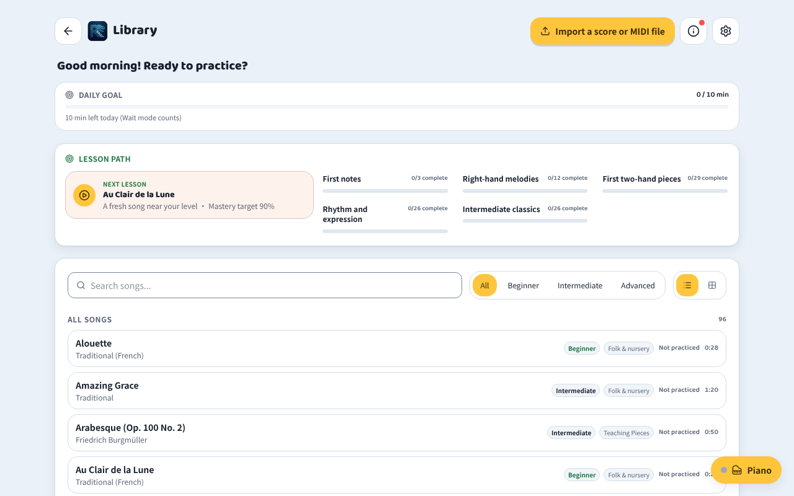
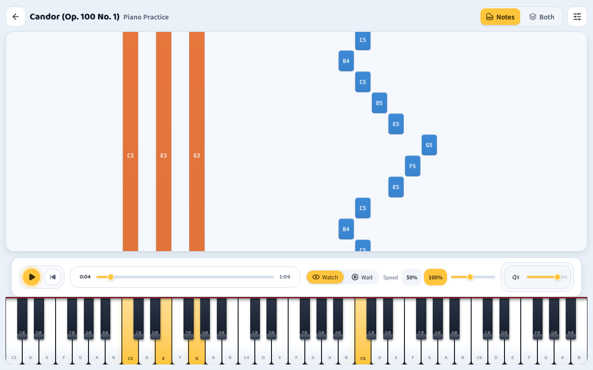
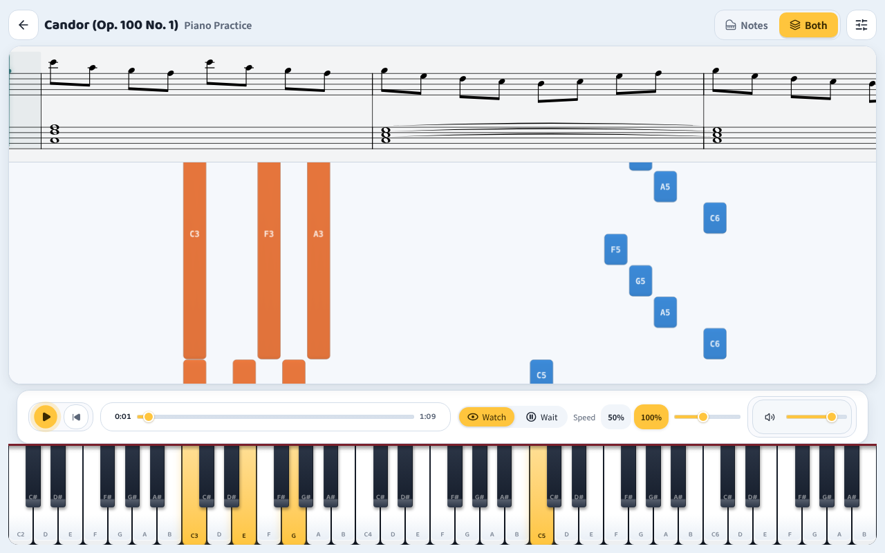

# Rexiano User Guide

> **Version**: 2.0 (web) | **Last updated**: 2026-11
>
> Other languages: [繁體中文](./user-guide.md)
>
> **TL;DR** - Press **Start Playing**, choose or import a score or MIDI song in the library, preview it, then start **Practice** or **Play Along**. In the player, use falling notes, sheet music, Wait mode, MIDI keyboard feedback, and practice reports to turn each session into a small, doable task.

---

## Table of Contents

1. [Quick Start](#1-quick-start)
2. [Song Library and MIDI Import](#2-song-library-and-midi-import)
3. [Player and Display Modes](#3-player-and-display-modes)
4. [Practice Modes and Speed](#4-practice-modes-and-speed)
5. [Connecting a Bluetooth Piano](#5-connecting-a-bluetooth-piano)
6. [Settings and Backup](#6-settings-and-backup)
7. [Keyboard Shortcuts](#7-keyboard-shortcuts)
8. [FAQ](#8-faq)
9. [Practice Tips for Parents](#9-practice-tips-for-parents)

---

## 1. Quick Start

Rexiano's main flow is: Start Playing -> Song Library -> Song Preview -> Practice or Play Along.

1. Open Rexiano. On first launch, follow the short welcome guide or skip it.
2. On the main menu, press **Start Playing**.
3. In the library, choose a built-in song or use **Import a score or MIDI file** for a `.musicxml` / `.mid` / `.midi` file.
4. In **Song preview**, check length, level, category, best score, and track count. Press **Preview** if you want to listen first.
5. Press **Practice** for a guided session; press **Play Along** to enter the player directly in free play.
6. In the player, press **Space** to play or pause. Start with **Watch**, then move to **Wait** for slow practice.

> **Screen callout**: The library header shows daily goal progress, the next recommendation, lesson path, and recent songs. Selecting a song opens the preview panel with the main action buttons.

---

## 2. Song Library and MIDI Import

The library is where you choose songs, organize your own MIDI files, and track progress.

| Area                       | What it does                                           | Best use                                       |
| -------------------------- | ------------------------------------------------------ | ---------------------------------------------- |
| Daily goal                 | Shows today's practiced minutes                        | Treat it as a gentle "sit down and play" cue   |
| Recommended next           | Suggests a song from your progress                     | Use it when you are not sure what to play      |
| Lesson path                | Groups built-in songs by level and progress            | Let children move through L0, L1, L2 gradually |
| Recent / Continue Practice | Reopens recently used scores and MIDI files            | Great for new teacher-assigned files           |
| All Songs                  | Built-in library with search, filters, sort, favorites | Favorite 2-3 songs for the week                |

There are 96 built-in songs: folk and children's songs, classics, and Teaching Pieces — Beyer (first two-hand playing), Czerny, Burgmüller's 25 Studies, the Anna Magdalena Notebook, sonatinas and Tchaikovsky's Children's Album. Search for a composer or "minuet" to find them.
| Imported scores & MIDI | Shows files you imported, kept in this browser | Edit title, composer, tags, level, and category |

### Import a Score or MIDI

1. Press **Import a score or MIDI file**, or drag a `.musicxml` / `.mid` / `.midi` file into the Rexiano window.
2. Imported files stay in this browser and are listed under **Imported scores & MIDI**, so you do not need to pick them again. Use the trash icon to remove one.
3. After import, click the song row. It opens the preview instead of starting playback immediately.
4. If the title or level is unclear, press the pencil icon to edit metadata for search and grouping.

### What to Choose in Song Preview

| Button         | Result                                                            |
| -------------- | ----------------------------------------------------------------- |
| **Preview**    | Plays a short audio preview without entering practice             |
| **Practice**   | Loads the song, usually asking you to choose **Wait** or **Free** |
| **Play Along** | Starts directly in Free mode, best for songs you already know     |

---

## 3. Player and Display Modes

The player combines notation, falling notes, piano keys, transport controls, and practice tools in one workspace.

> **Screen callout**: When a falling note reaches the hit line above the keyboard, it is time to play. The lower controls handle playback, speed, metronome, volume, and practice mode.

### Three Display Modes

| Mode                | What you see                           | Best for                                      |
| ------------------- | -------------------------------------- | --------------------------------------------- |
| **Notes (Falling)** | Falling notes plus the 88-key keyboard | Beginners and rhythm-game-style play          |
| **Sheet**           | Staff notation with a synced cursor    | Reading notation and checking pitch/rhythm    |
| **Both (Split)**    | Sheet music above, falling notes below | Connecting staff reading to keyboard position |

> **Screen callout**: Both / Split mode helps move a learner's attention from "where does it land?" toward "what does the notation say?"

### Playback Controls

| Control       | Function                                                    |
| ------------- | ----------------------------------------------------------- |
| Play / Pause  | Starts or pauses the loaded song                            |
| Back to start | Resets playback to 0:00                                     |
| Seek slider   | Jumps to any part of the song                               |
| Metronome     | Toggles beat cues; count-in runs before playback if enabled |
| Volume        | Adjusts Rexiano's internal volume                           |
| Audio status  | Shows loading, recovery, errors, and retry actions          |

The player also has side panels for **Practice Insights**, **Editor**, and **MIDI**. You can ignore them at first; Insights becomes more useful after a few saved sessions.

---

## 4. Practice Modes and Speed

Choosing the right mode and speed is more effective than always playing from the beginning.

| Mode      | Behavior                                       | Best for                                  |
| --------- | ---------------------------------------------- | ----------------------------------------- |
| **Watch** | Plays automatically while you watch and listen | First pass through a new song             |
| **Wait**  | Pauses at notes until you play them correctly  | Slow practice and fixing wrong notes      |
| **Free**  | Keeps playing while Rexiano tracks accuracy    | Testing rhythm and reaction once familiar |

### Recommended Practice Flow

1. Use **Watch** once to hear the song and see the hand split.
2. Switch to **Wait** and set speed to 50% or 75%.
3. Open **More** and select only the right-hand or left-hand track.
4. At a hard passage, drag the seek bar back to just before it and play it at 50%.
5. After three steady repeats, raise speed toward 100% and reconnect the passage.

### Speed and Tracks

| Control | What it does                                                           | Tip                                              |
| ------- | ---------------------------------------------------------------------- | ------------------------------------------------ |
| Speed   | Quick 50%, 75%, 100% buttons plus a 25%-200% slider                    | Start new songs at 50%, not full speed           |
| Tracks  | Chooses scored tracks and labels them right, left, both, or background | Mark accompaniment as background when needed     |
| Sound   | Per-track sound, solo, visibility, and color options                   | Solo the melody in teacher-made multi-track MIDI |

At the end of a session, Rexiano shows accuracy, hits, misses, best streak, new-record status, and a suggested next action.

---

## 5. Connecting a Bluetooth Piano

Rexiano supports Bluetooth (BLE-MIDI) pianos only. Without a piano you can still watch, listen, or tap the on-screen keys.

### Connect

1. Turn on the piano's Bluetooth (usually a long press on Function or Bluetooth, depending on the brand).
2. Open Rexiano in Chrome or Edge and press **Connect piano** on the home screen or at the bottom right of the library.
3. Pick your piano in the browser's dialog (Yamaha shows two names — pick the one ending in **MIDI**).
4. Once it says Connected, press a few keys; the on-screen keyboard should light up.

| Device                | How                                                                          |
| --------------------- | ---------------------------------------------------------------------------- |
| Windows / Mac / Linux | Chrome or Edge, press **Connect piano**; Safari on a Mac can't               |
| Android tablet        | Chrome, press **Connect piano**                                              |
| iPad                  | Install the free Bluefy browser, open Rexiano there, press **Connect piano** |

A piano already paired in the system (macOS Audio MIDI Setup, MIDIberry on Windows) can be picked under **Other ways to connect**.

### Let the piano play

With **Where the song plays** set to **Piano** (the default), the song plays on the piano once connected and the computer stays quiet:

- **Watch**: the piano plays the whole song.
- **Wait**: the piano plays only the hand you're not practising, and waits with you.
- The piano switches to its grand piano voice when it connects.
- If the piano sounds a little behind the falling notes, move **Line up the piano sound** to the right.

---

## 6. Settings and Backup

The gear at the top opens Settings, one card per topic:

| Card                    | Controls                                                   |
| ----------------------- | ---------------------------------------------------------- |
| Theme                   | System / Light / Dark                                      |
| Language                | English / 繁體中文                                         |
| Audio                   | Volume, mute                                               |
| Piano                   | Connect piano, where the song plays, other ways to connect |
| Line up the piano sound | Align the piano's sound with the screen                    |
| User Data Backup        | Export or import practice history and settings             |

Practice history and settings live in the browser. Export a **Backup** before switching computers or browsers or clearing site data.

The ⓘ at the top shows **What's new**, with a red dot when there's a version you haven't opened.

---

## 7. Keyboard Shortcuts

Shortcuts are ignored while typing in search boxes or metadata fields.

| Shortcut                  | Action                                                |
| ------------------------- | ----------------------------------------------------- |
| `Space`                   | Play / Pause                                          |
| `R`                       | Reset to beginning                                    |
| `←` / `→`                 | Rewind / fast forward 5 seconds                       |
| `Shift + ←` / `Shift + →` | Rewind / fast forward 15 seconds                      |
| `↑` or `]`                | Speed +25%                                            |
| `↓` or `[`                | Speed -25%                                            |
| `1` / `2` / `3`           | Switch Watch / Wait / Free                            |
| `M`                       | Mute / unmute                                         |
| `Esc`                     | Pause during playback; usually closes focused dialogs |
| `Ctrl+O` / `Cmd+O`        | Open a score or MIDI file                             |
| `?`                       | Show / hide shortcut help                             |

---

## 8. FAQ

### I cannot hear sound. What should I check?

1. Check Rexiano volume and system volume.
2. Make sure mute is off, or press `M`.
3. The SoundFont can take a few seconds to load the first time; wait if loading is shown.
4. If audio shows an error, use the retry action, or enable audio compatibility mode in Settings and reload the song.

### Rexiano cannot find my Bluetooth piano. What should I do?

1. Make sure the piano's Bluetooth MIDI is on and not connected to a phone or another app.
2. Use Chrome or Edge; on iPad use Bluefy. Safari has no Web Bluetooth.
3. Press **Connect piano** and pick the piano in the browser's dialog; no system pairing is needed first.
4. Still nothing: turn the piano off and on, reload Rexiano and connect again.

### I imported a file, but now Rexiano cannot find it.

Recent files remember their original path. If the file moved or was deleted, Rexiano shows a recovery prompt. Import it again from the new location, or remove the stale recent item.

### Why do some notes not show labels?

Very short notes hide text automatically to prevent label overlap. Switch to **Both** to read the pitch on the staff, or slow the song down.

### Should I use sheet music or falling notes?

Start with Notes / Falling to learn which keys to press. Move to Both / Split once the song is familiar. Use Sheet when you are ready to practice notation-first reading.

---

## 9. Practice Tips for Parents

Rexiano works best when practice becomes short, clear, and finishable.

1. **Use 10-20 minute sessions**: build consistency before length.
2. **Start with L0 / L1**: easy songs create early wins.
3. **Listen before playing**: use Watch once, then Wait.
4. **Slow is faster**: 50% speed with correct notes beats repeated full-speed mistakes.
5. **Practice one hand at a time**: use track controls for right hand, then left hand, then both.
6. **Practise hard spots in small pieces**: drag back before the passage; reconnect after three steady repeats.
7. **Read the parent report, not one score**: 7-day and 30-day trends are better than a single session.
8. **Praise specific progress**: "That C to G passage was steadier today" helps more than generic praise.

_Rexiano is free, open-source software released under GPL-3.0. Source code: [github.com/EndeavorYen/Rexiano](https://github.com/EndeavorYen/Rexiano)._
